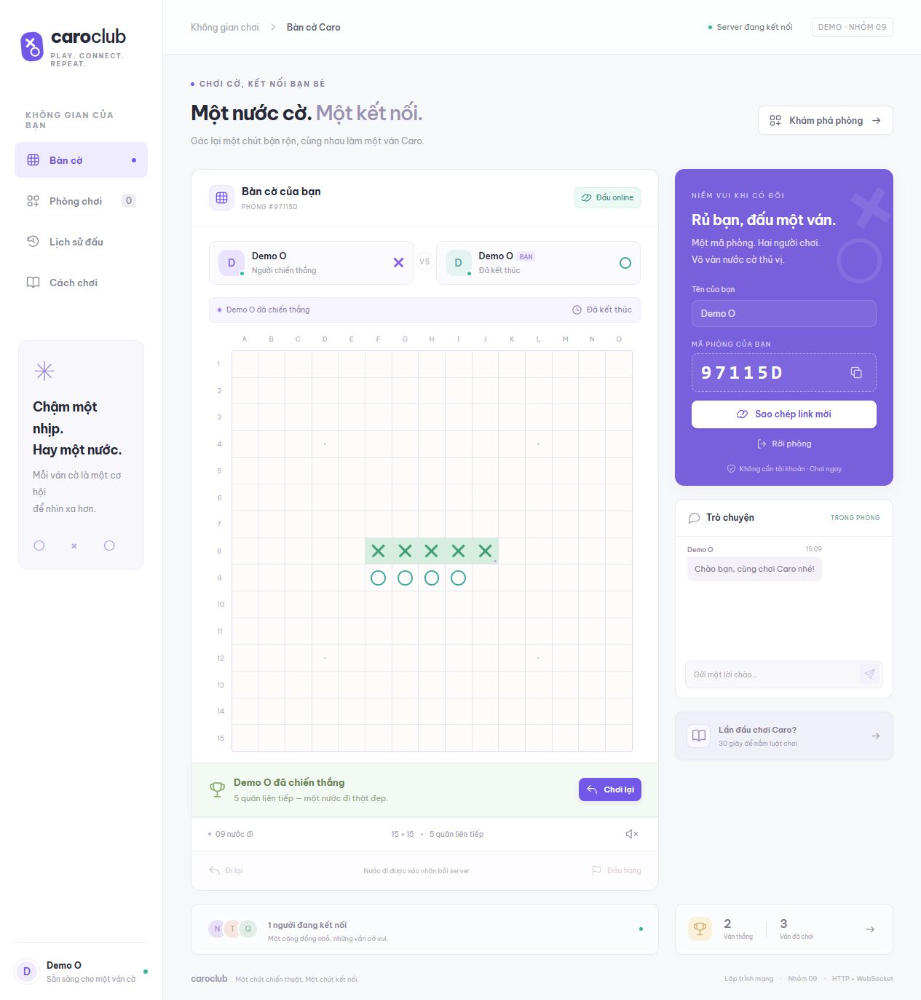

# Caro Club — Game Caro online

Bản demo bài tập lớn **Lập trình mạng · Nhóm 09**. Chơi Caro 15×15 với máy hoặc đấu hai người qua WebSocket, có tạo phòng, chat, đếm giờ và kết nối lại.



| Thành viên | MSSV |
| --- | --- |
| Nguyễn Huy Hoàng | B23DCCN336 |
| Lê Doãn Trung | B23DCCN854 |
| Nguyễn Công Quân | B23DCCN678 |

## Chạy nhanh

Yêu cầu **Node.js 22 trở lên**, npm và trình duyệt hiện đại. Không cần Java hoặc cơ sở dữ liệu cho bản demo.

```powershell
cd source
npm install
npm run build
npm start
```

Mở **http://localhost:3000**. Dừng server bằng `Ctrl+C`.

Khi phát triển, chạy `npm run dev` từ `source/` để tự cập nhật giao diện, không cần build mỗi lần. Chạy `npm test` để kiểm tra luật cờ, quản lý phòng và HTTP/WebSocket với hai client thật.

Nếu cổng 3000 đang được dùng:

```powershell
$env:PORT="3001"
npm start
```

## Kịch bản demo trên một máy

1. Mở trang, bấm các ô để **đấu với máy**. Có thể đi lại nước vừa đánh.
2. Nhập tên, bấm **Tạo phòng mới** và sao chép mã phòng.
3. Mở **tab độc lập** bằng cách nhập địa chỉ vào tab mới, hoặc dùng trình duyệt khác. Nhập tên người thứ hai và mã phòng, bấm **Vào phòng**. Không dùng Duplicate tab vì trình duyệt có thể sao chép phiên của người thứ nhất.
4. Luân phiên đánh, gửi chat và quan sát bàn cờ đồng bộ. Mỗi lượt online có 30 giây.
5. Người có từ 5 quân liên tiếp thắng. Có thể đầu hàng để demo kết thúc; cả hai bấm **Chơi lại** để bắt đầu ván mới và đổi X/O.
6. Tải lại trang trong lúc chơi: token theo tab giúp khôi phục phiên. Đồng hồ tạm dừng khi một người mất kết nối, tối đa 30 giây; quá hạn xử thua người mất kết nối.

Đấu qua LAN: máy chủ chạy server; hai máy cùng mạng mở `http://<IPv4-may-chu>:3000`. Xem IPv4 bằng `ipconfig`. QR và link mời tự chọn IPv4 LAN kể cả khi máy chủ mở trang bằng localhost. Nếu Windows hỏi tường lửa, chủ máy cần cho phép Node.js trên mạng riêng đang dùng.

## Chức năng đã có

- Giao diện tiếng Việt, responsive, điều khiển bàn cờ bằng phím mũi tên và Enter.
- Máy luyện tập ưu tiên thắng, chặn đối thủ rồi mở rộng đường cờ; có đi lại, đầu hàng, chơi lại.
- Phòng hai người: mã 6 ký tự, danh sách phòng chờ, tham gia bằng mã hoặc link mời.
- QR mời phòng chọn IP Wi-Fi/LAN tự động; điện thoại quét QR và nhập tên ngay đầu trang để vào chơi.
- Server xác nhận lượt, vị trí, ô trống, thắng/hòa, thời gian; client không tự quyết kết quả online.
- Chat trong phòng, tối đa 300 ký tự/tin, giữ 60 tin gần nhất.
- Hai người đồng ý để chơi lại; tự đổi bên ở ván mới.
- Kết nối lại trong 30 giây, heartbeat WebSocket, dọn phiên vắng mặt.
- Lịch sử 30 ván trên trình duyệt, thống kê cá nhân và bật/tắt âm thanh.

**Luật demo:** từ 5 quân liên tiếp theo ngang/dọc/chéo là thắng, kể cả bị chặn cả hai đầu. Bàn kín không có người thắng thì hòa. Đấu máy không giới hạn giờ; online hết giờ, đầu hàng hoặc rời phòng trong khi chơi sẽ thua.

## Kiến trúc

```text
React + TypeScript (Browser A) ──┐
                               ├── HTTP + WebSocket ── Node.js server
React + TypeScript (Browser B) ──┘                       ├── RoomService
                                                       ├── Game rules
                                                       └── RAM: rooms / sessions / chat
```

| Thành phần | Công nghệ demo | Vai trò |
| --- | --- | --- |
| Client | React 19, TypeScript, Vite 6 | Giao diện, WebSocket client, bot |
| Server | Node.js 22+, thư viện ws | HTTP, WebSocket, quản lý phòng, đồng hồ |
| Luật cờ | JavaScript module dùng chung | Kiểm tra thắng và chiến thuật máy |
| Dữ liệu | RAM + browser storage | Phòng/chat trên server; tên/lịch sử trên trình duyệt; token theo tab |
| Kiểm thử | node:test | Luật cờ, quản lý phòng, hai client WebSocket thật |

**Khác định hướng ban đầu:** thiết kế ban đầu dự kiến Java/Spring Boot và PostgreSQL. Demo này dùng Node.js để chạy bằng một bộ công cụ; chưa có Spring Boot/PostgreSQL. Có thể chuyển RoomService và giao thức sang backend Java ở giai đoạn tiếp theo.

## HTTP và giao thức WebSocket

| Endpoint | Giao thức | Mô tả |
| --- | --- | --- |
| GET / | HTTP | Phục vụ giao diện React đã build |
| GET /health | HTTP/JSON | Trả status, số phòng và transport WebSocket |
| GET /api/connection | HTTP/JSON | Các địa chỉ LAN và URL public đã cấu hình để tạo QR |
| /ws | WebSocket | Kết nối hai chiều, gói tin JSON |

Client mở `/ws`, gửi `hello` trước hành động khác. Token do server sinh ngẫu nhiên, lưu `sessionStorage` để mỗi tab độc lập có người chơi riêng.

| Client → server | Dữ liệu mẫu |
| --- | --- |
| Kết nối / tiếp tục phiên | `{ "type": "hello", "token": null }` |
| Tạo phòng | `{ "type": "create", "name": "An" }` |
| Tham gia | `{ "type": "join", "name": "Bình", "roomId": "A1B2C3" }` |
| Đánh cờ | `{ "type": "move", "index": 112 }` |
| Chat | `{ "type": "chat", "text": "Xin chào!" }` |
| Đầu hàng | `{ "type": "resign" }` |
| Đồng ý ván mới | `{ "type": "rematch" }` |
| Rời phòng | `{ "type": "leave" }` |

Chỉ số ô 0–224, bằng `row * 15 + column` (hàng/cột từ 0). Server gửi `welcome` (id, token, giờ server), `lobby` (phòng chờ, số phiên online), `room` (snapshot bàn cờ, người chơi, lượt, deadline, chat, kết quả), `left`, `error`. Mỗi nước hợp lệ tạo một snapshot gửi cả hai người. Chat cũng gửi snapshot đầy đủ để giữ giao thức đơn giản cho demo.

## Cấu trúc

```text
caro-network-project/
├── README.md
├── INSTRUCTION.md              # Giữ nguyên tài liệu giảng viên
├── statics/
│   ├── diagram.png
│   └── logo.png
└── source/
    ├── package.json
    ├── package-lock.json
    ├── client/
    │   ├── README.md
    │   ├── index.html
    │   ├── tsconfig.json
    │   ├── vite.config.ts
    │   └── src/
    │       ├── main.tsx
    │       ├── App.tsx
    │       ├── InvitePanel.tsx   # QR và link mời LAN/Internet
    │       └── styles.css
    ├── server/
    │   ├── README.md
    │   ├── index.mjs            # HTTP, WebSocket, heartbeat, phục vụ giao diện
    │   ├── connection.mjs       # Chọn địa chỉ LAN, PUBLIC_URL, kiểm tra Origin
    │   ├── rooms.mjs            # Phòng, phiên, nước đi, chat, đồng hồ
    │   └── test/
    │       ├── game.test.mjs
    │       ├── connection.test.mjs
    │       ├── rooms.test.mjs
    │       └── network.test.mjs
    └── shared/
        ├── game.mjs            # Luật cờ, bot
        └── game.d.mts          # Kiểu cho TypeScript
```

## Giới hạn demo

- Phòng, phiên, chat lưu RAM, mất khi khởi động lại server. Tối đa 100 phòng và 1.000 phiên.
- Không có đăng nhập, PostgreSQL, bảng xếp hạng chung, hoặc xem lại lịch sử nước đi.
- Lịch sử trình duyệt không phải dữ liệu xác thực, có thể mất khi xóa dữ liệu. Luyện tập không được server xác nhận.
- Một phiên chỉ có một kết nối. Tab nhân bản có thể dùng chung token; mở tab độc lập/trình duyệt khác để demo hai người.
- Server giới hạn payload 8 KB, tốc độ gói tin/chat và kiểm tra Origin cùng host cho trình duyệt. Local/LAN dùng HTTP; triển khai Internet cần HTTPS/WSS, xác thực và lưu trữ bền vững.
- Google Fonts là tài nguyên tùy chọn, có font hệ thống dự phòng. Sau cài thư viện và build, game chạy local không cần dịch vụ bên ngoài.

## Quét QR bằng điện thoại

1. Máy tính và điện thoại dùng **cùng Wi-Fi**. Chạy server rồi mở game trên máy tính.
2. Nhập tên và **Tạo phòng mới**. Thẻ mời hiển thị QR và link có IPv4 LAN, không dùng localhost.
3. Điện thoại mở Camera/Zalo quét QR. Trang mở với lời mời ở đầu trang: nhập tên rồi bấm **Vào phòng**.
4. Chơi như bình thường; HTTP và WebSocket đều đi qua cùng cổng. Nếu có nhiều card mạng, chọn đúng địa chỉ trong danh sách cạnh QR.

Nếu điện thoại không mở được link, kiểm tra cùng Wi-Fi, mạng khách có cô lập thiết bị hay không, và quyền Node.js trong Windows Firewall. Máy chủ phải tiếp tục chạy. Khi IP Wi-Fi thay đổi, tải lại trang/tạo lại QR. Trên HTTP LAN, trình duyệt có thể không cho sao chép tự động; có thể nhấn giữ link để sao chép.

### Chơi qua 4G/5G hoặc Wi-Fi khác

QR chứa một đường link, không tự mở cổng Internet. Để chơi khác mạng, server cần một URL public qua hosting hoặc tunnel. Demo hỗ trợ biến môi trường **PUBLIC_URL** để cả QR và kiểm tra Origin của WebSocket dùng đúng tên miền public.

Ví dụ với [Cloudflare Quick Tunnel](https://developers.cloudflare.com/tunnel/get-started/quick-tunnels/) sau khi cài cloudflared theo tài liệu chính thức:

```powershell
# Cửa sổ riêng: tạo link tạm cho server chạy trên cổng 3001
cloudflared tunnel --url http://localhost:3001
```

Sau khi công cụ in ra địa chỉ https://...trycloudflare.com, khởi động lại game từ source/ với **địa chỉ thực tế vừa được cấp**:

```powershell
$env:PORT="3001"
$env:PUBLIC_URL="https://TEN-THUC-TE.trycloudflare.com"
npm start
```

Giữ cả server và tunnel chạy, tạo phòng mới và quét QR Internet. Khởi động lại server sẽ xóa các phòng cũ. URL ví dụ ở trên không phải URL đã triển khai. Quick Tunnel dùng cho thử nghiệm, địa chỉ thay đổi mỗi lần chạy; người có link có thể truy cập demo. Chưa tự tạo hay công bố tunnel trong repo này.

API **GET /api/connection** trả danh sách địa chỉ LAN và PUBLIC_URL đã cấu hình. Không tin các header proxy tùy ý để cấp quyền WebSocket; chỉ chấp nhận cùng host hoặc đúng PUBLIC_URL được chủ server đặt.
